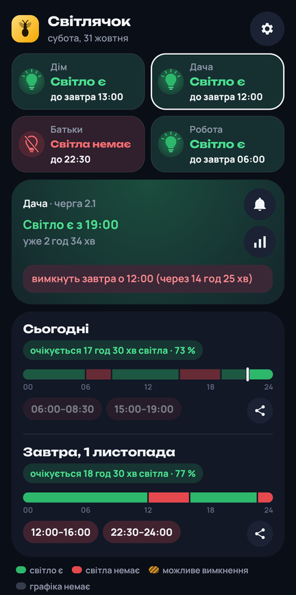
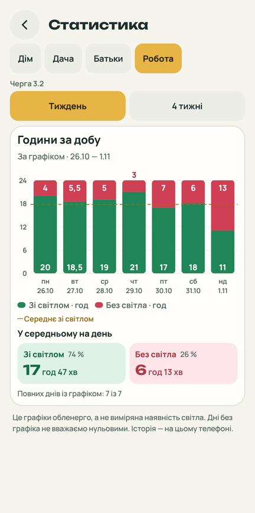
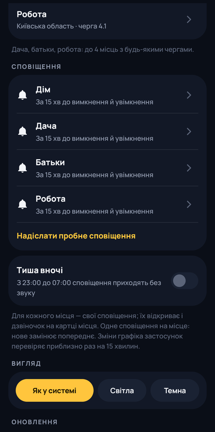
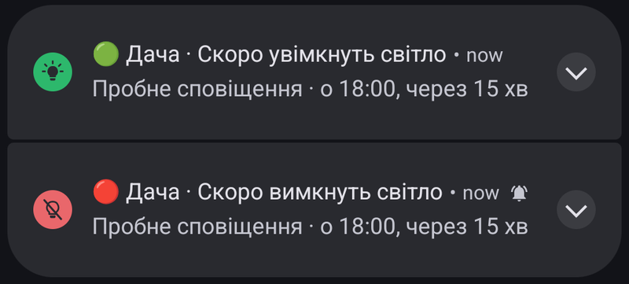
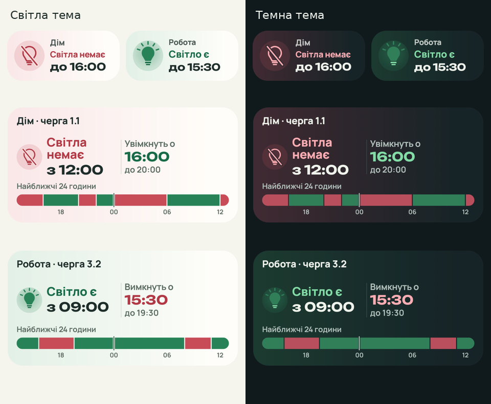
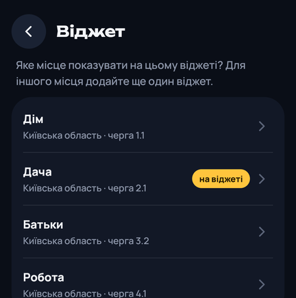
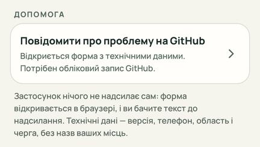

# Світлячок

[](https://github.com/ABovsh/svitlyachok/actions/workflows/ci.yml)
[](https://sonarcloud.io/summary/new_code?id=ABovsh_svitlyachok)
[](https://sonarcloud.io/summary/new_code?id=ABovsh_svitlyachok)
[](https://sonarcloud.io/summary/new_code?id=ABovsh_svitlyachok)
[](https://sonarcloud.io/summary/new_code?id=ABovsh_svitlyachok)
[](https://sonarcloud.io/summary/new_code?id=ABovsh_svitlyachok)
[](https://github.com/ABovsh/svitlyachok/releases/latest)
[](LICENSE)

Android-застосунок із графіком погодинних відключень світла: чи є світло зараз, до котрої години
і що буде завтра — для одного або кількох місць. Нагадує перед вимкненням і перед увімкненням.

Працює для 14 областей (список — у розділі [Області](#області)). **Місто Київ поки не
підтримується.**

Світлячок з'явився як застосунок для моєї тещі: щоб їй було простіше стежити за відключеннями.
Ця версія — для всіх, хто хоче знати графік свого будинку, дачі чи батьків без зайвих кроків.

<p align="center">
  
  
  
  
</p>

## 🔒 Приватність

**Світлячок нічого не надсилає з телефона.**

- У мережі застосунок робить дві речі: завантажує відкритий файл графіка вашої області з GitHub
  (`raw.githubusercontent.com`) і, коли ви його відкриваєте (не частіше двох разів на день),
  питає `github.com`, яка версія остання. У запитах немає ваших місць, черг чи налаштувань.
  Непотрібну версію можна пропустити — застосунок запропонує лише наступну.
- Місця, черги й налаштування зберігаються тільки на телефоні. Вони не потрапляють у
  резервну копію Google і не переносяться на інший телефон.
- Без облікового запису, реклами, аналітики й сторонніх бібліотек.
- Лише зашифровані з'єднання (HTTPS): незашифровані заборонені в налаштуваннях безпеки
  застосунку.
- Як і будь-який сайт, GitHub бачить IP-адресу телефона й те, файл якої області завантажено.

Навіщо застосунку дозволи:

| Дозвіл | Навіщо |
|---|---|
| Інтернет, стан мережі | завантажити графік і перевіряти його оновлення |
| Сповіщення | нагадування перед вимкненням і увімкненням |
| Точні будильники | щоб нагадування приходило точно у свій час |
| Запуск після ввімкнення телефона | відновити нагадування й віджети після перезавантаження |
| Виняток з економії батареї | один раз запитати, щоб телефон не відкладав нагадування |

## Що вміє

### 📅 Графік вашої черги

- Що зараз за графіком і відколи: «Світло є з 19:00, уже 2 год 09 хв».
- Коли зміниться стан і скільки до цього: «вимкнуть о 21:00 (через 1 год 51 хв)».
- Сьогодні й завтра: смуга на 24 години, години вимкнень і скільки годин світла очікується.
- 14 областей — [список](#області).

### 🔔 Нагадування

- Одразу після встановлення увімкнено два: за 15 хвилин до вимкнення і за 15 хвилин до
  увімкнення світла.
- Для кожного місця — свої: дзвіночок на картці місця відкриває його сповіщення. Якщо для місця
  не ввімкнено нічого, дзвіночок перекреслений.
- Що станеться, а нижче — коли: «🔴 Скоро вимкнуть світло» / «о 18:30, через 15 хв». Коли місць
  кілька, на початку — назва місця.

  
- [Докладніше про сповіщення](#сповіщення)

### 📍 Кілька місць

- До 4 місць з будь-якими областями й чергами: дім, дача, батьки, робота.
- Кожне місце — плитка з його станом на головному екрані; натисніть, щоб побачити графік.

### 📤 Поділитися

- Кнопка біля годин вимкнень — окремо для сьогодні й для завтра. Графік дня надсилається
  картинкою у Viber, Telegram чи куди завгодно, з посиланням, де завантажити застосунок.
- На картинці — черга, область і дата, без назви вашого місця.

### 🧩 Віджети



- Свій віджет для кожного місця: лампочка, стан, до котрої години, назва місця.
- Від 2×1; розтягнутий до 4×2 показує ще й смугу наступних 24 годин.
- Оновлюється сам у моменти змін, без відкриття застосунку.
- [Як додати віджет](#віджети)

### 📊 Статистика

- Кнопка під дзвіночком на картці місця: стовпчик на кожен день за тиждень або місяць і
  середня кількість годин світла на день.
- [Докладніше](#статистика)

### 🔄 Графік оновлюється сам

- Приблизно раз на 15 хвилин застосунок перевіряє, чи обленерго змінило графік, — і коли він
  закритий, і щоразу, коли ви його відкриваєте. Новий графік з'являється на екрані й на
  віджетах сам.
- Якщо джерело не відповідає понад 3 години, з'являється попередження, а на екрані лишається
  останній збережений графік.

### ⬆️ Оновлення застосунку

- Про нову версію повідомляє картка на головному екрані: «Завантажити», «Що нового» і
  «Пропустити цю версію» — тоді застосунок запропонує лише наступну. Окремих сповіщень про
  оновлення немає.

### 🆘 Повідомити про проблему

- У налаштуваннях, у розділі «Допомога»: форма на GitHub, де технічні дані вже заповнені.
  [Докладніше](#повідомити-про-проблему)

Світла й темна тема — як у системі або на вибір.

## Як читати екран

- **Плитки місць** вгорі: лампочка й колір показують стан зараз, нижче — до котрої години він
  триває.
- **Кольори**: зелений — світло є, червоний — світла немає, бурштиновий — можливе вимкнення,
  сірий — графіка ще немає. Лампочка дублює стан формою: з променями, перекреслена, наполовину
  залита, контур — тож його видно й без розрізнення кольорів.
- **Картка місця**: відколи триває стан, а нижче — коли він зміниться й через скільки. Підказка
  має колір наступної події: червонуватий перед вимкненням, зеленуватий перед увімкненням; коли
  до зміни менше 30 хвилин, вона заливається цим кольором. Праворуч — дзвіночок (сповіщення
  цього місця) і кнопка статистики.
- **Сьогодні й завтра**: скільки годин світла очікується за графіком — «очікується 16 год
  світла · 67 %».
- **Смуга на 24 години**: біла риска — зараз, минулі години притемнені. Під смугою — години
  вимкнень; «зараз» позначає те, що триває, минулі бліді.

## Докладніше

### Сповіщення

- Перед вимкненням можна обрати «Одразу» (у момент зміни) або 10–60 хвилин наперед, перед
  увімкненням — «Одразу» або 5–30 хвилин.
- Заголовок — що станеться: 🔴 — вимкнення, 🟢 — увімкнення, 🟠 — можливе вимкнення, наприклад
  «🔴 Скоро вимкнуть світло»; нижче — коли: «о 18:30, через 15 хв». У момент зміни —
  «Вимкнення за графіком» / «до 22:30». Коли місць два й більше, перед заголовком — назва
  місця: «🔴 Дім · Скоро вимкнуть світло».
- Усе це налаштовується окремо для кожного місця — дзвіночком на його картці або в
  налаштуваннях, у розділі «Сповіщення».
- Для кожного місця на телефоні лишається одне сповіщення: нове замінює попереднє. Нагадування
  зникає саме, коли вже не потрібне: після кінця вимкнення або через годину після увімкнення.
- Додатково, якщо потрібно, вмикаються:
  - **Графік на завтра** — щойно обленерго його опублікує, зі списком вимкнень;
  - **Зміни графіка** — якщо обленерго змінило години на сьогодні або завтра;
  - **Тиша вночі** — з 23:00 до 07:00 сповіщення приходять без звуку (одна для всіх місць).
- Кнопка «Надіслати пробне сповіщення» показує, як виглядають обидва нагадування.

### Віджети

Додати віджет можна трьома способами:

- щойно ви додали нове місце, застосунок пропонує поставити його віджет на головний екран;
- кнопка віджета в шапці головного екрана — для обраного місця, поки в нього немає віджета;
- через список віджетів телефона — тоді застосунок запитає, яке місце показувати.

  

Коли місць кілька, на віджеті завжди видно назву місця. Віджет оновлюється й після
перезавантаження телефона.

### Статистика

- Стовпчик на кожен день: зелене — світло за графіком, червоне — без світла, бурштинове —
  можливе вимкнення. На тижневому — ще й години світла в кожному стовпчику.
- Під графіком — середнє за період: «У середньому 16 год 51 хв зі світлом на день · 70 %».
- Обленерго публікує графік лише на сьогодні й завтра, тож статистика накопичується на телефоні
  з дня встановлення — до місяця. Дні, коли графіка не було, лишаються порожніми.

### Оновлення

- Нова версія встановлюється поверх попередньої, місця й налаштування зберігаються.
- Android встановлює її лише тоді, коли вона підписана тим самим ключем, тож чужа збірка поверх
  не стане.

### Повідомити про проблему



- У браузері відкривається форма на GitHub, де технічні дані вже заповнені; потрібен обліковий
  запис GitHub.
- Технічні дані — версія застосунку й Android, модель телефона, область і черга, стан
  сповіщень. Назв ваших місць там немає. Застосунок нічого не надсилає сам: ви бачите текст
  до надсилання.

## Встановлення

### Завантажити готовий APK

1. На телефоні відкрийте [останній випуск](https://github.com/ABovsh/svitlyachok/releases/latest)
   і завантажте файл `Svitlyachok-<версія>.apk`.
2. Відкрийте завантажений файл. Якщо телефон попросить, дозвольте браузеру встановлювати
   застосунки.
3. Запустіть Світлячок (якщо мова телефона не українська, під значком — «Svitlyachok»):
   оберіть область, чергу й назву місця, дозвольте сповіщення.

Про нову версію застосунок повідомить сам, на головному екрані. Біля кожного APK у випуску вказано
його SHA-256 — ним можна перевірити, що файл не змінено.

### Зібрати самостійно

Потрібні JDK 17 і Android SDK (API 35).

```bash
git clone https://github.com/ABovsh/svitlyachok.git
cd svitlyachok
./gradlew testDebugUnitTest assembleRelease
```

Готовий файл — `app/build/outputs/apk/release/app-release.apk`, підписаний вашим локальним
ключем налагодження. Через інший підпис він не встановиться поверх APK зі сторінки випусків:
спершу видаліть попередню версію.

## Області

Київська, Вінницька, Дніпропетровська, Житомирська, Закарпатська, Запорізька,
Івано-Франківська, Львівська, Одеська, Полтавська, Рівненська, Тернопільська, Хмельницька
й Чернігівська. Київ (місто) поки не підтримується: його графік публікується в іншому
форматі.

Графіки беруться з відкритих архівів на GitHub, які збирають їх із сайтів обленерго:
[Baskerville42/outage-data-ua](https://github.com/Baskerville42/outage-data-ua),
[yaroslav2901/OE_OUTAGE_DATA](https://github.com/yaroslav2901/OE_OUTAGE_DATA),
[olnet93/gpv-voe-vinnytsia](https://github.com/olnet93/gpv-voe-vinnytsia),
[vn-progr/gpv-voe-vinnytsia](https://github.com/vn-progr/gpv-voe-vinnytsia) і
[milkmann/gpv-zoe-zaporizhzhia](https://github.com/milkmann/gpv-zoe-zaporizhzhia).

## Важливо

Світлячок показує графік, який публікує обленерго, а не фактичну наявність світла у вашому
будинку. Застосунок не пов'язаний з ДТЕК чи іншими обленерго.

Як застосунок влаштований — [ARCHITECTURE.md](ARCHITECTURE.md), що змінилося —
[CHANGELOG.md](CHANGELOG.md). Про вразливість повідомте за [SECURITY.md](SECURITY.md).

## Ліцензія

[MIT](LICENSE). Шрифти Unbounded і Manrope — SIL Open Font License
([`app/src/main/assets/fonts`](app/src/main/assets/fonts)).
