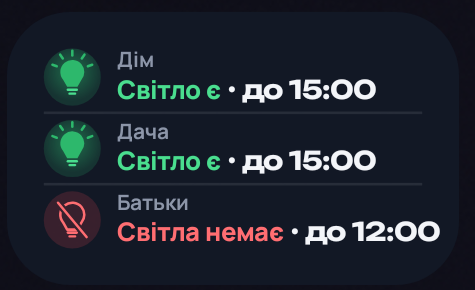

# Світлячок

[](https://github.com/ABovsh/svitlyachok/actions/workflows/ci.yml)
[](https://sonarcloud.io/summary/new_code?id=ABovsh_svitlyachok)
[](https://sonarcloud.io/summary/new_code?id=ABovsh_svitlyachok)
[](https://sonarcloud.io/summary/new_code?id=ABovsh_svitlyachok)
[](https://sonarcloud.io/summary/new_code?id=ABovsh_svitlyachok)
[](https://sonarcloud.io/summary/new_code?id=ABovsh_svitlyachok)
[](https://github.com/ABovsh/svitlyachok/releases/latest)
[](https://github.com/ABovsh/svitlyachok/releases)
[](LICENSE)

Android-застосунок із графіком погодинних відключень світла: що зараз, до котрої години
і що буде завтра — для одного або кількох місць. Нагадує перед вимкненням і перед
увімкненням світла.

| Головний екран | Світла тема | Налаштування | Віджет |
|---|---|---|---|
|  |  |  |  |

## 🔒 Приватність

**Світлячок нічого не надсилає з телефона.**

- У мережі застосунок робить дві речі: завантажує відкритий файл графіка вашої області з GitHub
  (`raw.githubusercontent.com`) і, коли ви його відкриваєте (не частіше двох разів на день),
  питає `github.com`, яка версія Світлячка остання. У запитах немає ваших місць, черг чи
  налаштувань. Перевірку версії можна вимкнути в налаштуваннях.
- Місця, черги й налаштування зберігаються тільки на телефоні. Вони не потрапляють у
  резервну копію Google і не переносяться на інший телефон.
- Без облікового запису, реклами, аналітики й сторонніх бібліотек.
- Лише зашифровані з'єднання (HTTPS): незашифровані заборонені в налаштуваннях безпеки
  застосунку.
- Як і будь-який сайт, GitHub бачить IP-адресу телефона й те, файл якої області завантажено.

Навіщо застосунку дозволи:

| Дозвіл | Навіщо |
|---|---|
| Інтернет, стан мережі | завантажити графік і перевіряти його оновлення |
| Сповіщення | нагадування перед вимкненням і увімкненням |
| Точні будильники | щоб нагадування приходило точно у свій час |
| Запуск після ввімкнення телефона | відновити нагадування після перезавантаження |
| Виняток з економії батареї | один раз запитати, щоб телефон не відкладав нагадування |

## Що вміє

### 💡 Зараз і далі

- Лампочка й колір показують стан без читання: зелений — світло є, червоний — світла немає,
  бурштиновий — можливе вимкнення, сірий — графіка немає.
- До котрої години триває поточний стан, через скільки він зміниться і що буде потім.
- Сьогодні й завтра: смуга на 24 години й години вимкнень.

### 📍 Кілька місць

- До 4 місць з будь-якими областями й чергами: дім, дача, батьки, робота.
- На головному екрані — плитка для кожного місця з його станом. Натисніть плитку, щоб
  побачити графік цього місця.
- Дзвіночок вимикає сповіщення одного місця.

### 🔔 Сповіщення

- Одразу після встановлення увімкнено лише два: перед вимкненням світла (за 30 хв) і перед
  увімкненням (за 15 хв). Час можна змінити або обрати «Одразу» — у момент зміни.
- Решта вимкнена, доки ви її не ввімкнете: графік на завтра, щойно його опубліковано, зміни
  графіка й тиша вночі (з 23:00 до 07:00 сповіщення приходять без звуку).
- Нагадування приходять у свій час і тоді, коли застосунок закритий.

### 🧩 Віджет

- Від 2×1. На віджеті одне місце або кілька: їх обирають, коли додають віджет, а на Android 12
  і новіших — ще й довгим натисканням на віджет.
- Віджет з одним місцем розміром 4×2 показує ще й смугу наступних 24 годин.

### ⬆️ Оновлення

- Коли виходить нова версія, на головному екрані з'являється картка з кнопками «Завантажити» і
  «Що нового». Окремих сповіщень про оновлення немає: що встановлювати і коли, вирішуєте ви.
- Нова версія встановлюється поверх попередньої, місця й налаштування зберігаються. Android
  встановлює її лише тоді, коли вона підписана тим самим ключем, тож чужа збірка поверх не стане.

Світла й темна тема — як у системі або на вибір.

## Встановлення

### Завантажити готовий APK

1. На телефоні відкрийте [останній випуск](https://github.com/ABovsh/svitlyachok/releases/latest)
   і завантажте файл `Svitlyachok-<версія>.apk`.
2. Відкрийте завантажений файл. Якщо телефон попросить, дозвольте браузеру встановлювати
   застосунки.
3. Запустіть Світлячок: оберіть область, чергу й назву місця, дозвольте сповіщення.

Про нову версію Світлячок скаже сам, на головному екрані. Біля кожного APK у випуску вказано
його SHA-256 — ним можна перевірити, що файл не змінено.

### Зібрати самостійно

Потрібні JDK 17 і Android SDK (API 35).

```bash
git clone https://github.com/ABovsh/svitlyachok.git
cd svitlyachok
./gradlew testDebugUnitTest assembleRelease
```

Готовий файл — `app/build/outputs/apk/release/app-release.apk`, підписаний вашим локальним
ключем налагодження. Через інший підпис він не встановиться поверх APK зі сторінки випусків:
спершу видаліть попередній Світлячок.

## Області

Київська, Вінницька, Дніпропетровська, Житомирська, Закарпатська, Запорізька,
Івано-Франківська, Львівська, Одеська, Полтавська, Рівненська, Тернопільська, Хмельницька
й Чернігівська. Київ (місто) поки не підтримується: його графік публікується в іншому
форматі.

Графіки беруться з відкритих архівів на GitHub, які збирають їх із сайтів обленерго:
[Baskerville42/outage-data-ua](https://github.com/Baskerville42/outage-data-ua),
[yaroslav2901/OE_OUTAGE_DATA](https://github.com/yaroslav2901/OE_OUTAGE_DATA),
[olnet93/gpv-voe-vinnytsia](https://github.com/olnet93/gpv-voe-vinnytsia),
[vn-progr/gpv-voe-vinnytsia](https://github.com/vn-progr/gpv-voe-vinnytsia) і
[milkmann/gpv-zoe-zaporizhzhia](https://github.com/milkmann/gpv-zoe-zaporizhzhia).

## Важливо

Світлячок показує графік, який публікує обленерго, а не фактичну наявність світла у вашому
будинку. Застосунок не пов'язаний з ДТЕК чи іншими обленерго.

Як застосунок влаштований — [ARCHITECTURE.md](ARCHITECTURE.md). Знайшли помилку — відкрийте
[issue](https://github.com/ABovsh/svitlyachok/issues); про вразливість повідомте за
[SECURITY.md](SECURITY.md).

## Ліцензія

[MIT](LICENSE). Шрифти Unbounded і Manrope — SIL Open Font License
([`app/src/main/assets/fonts`](app/src/main/assets/fonts)).
