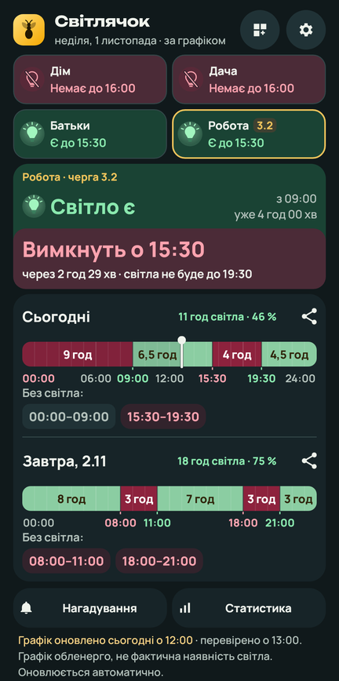
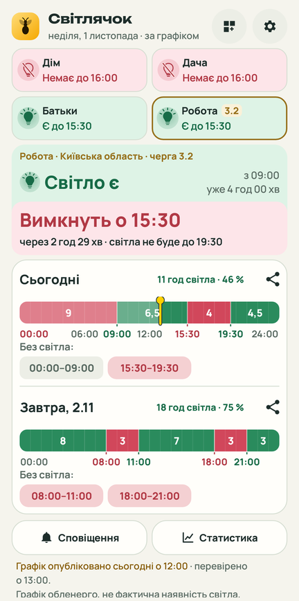
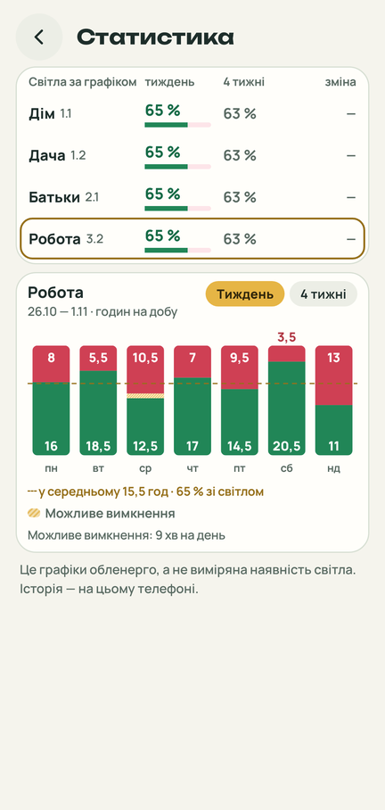
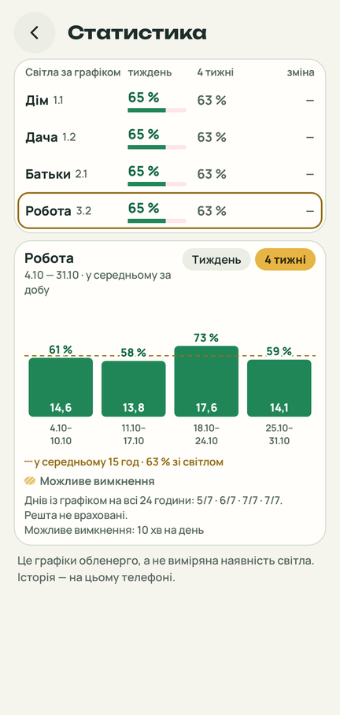
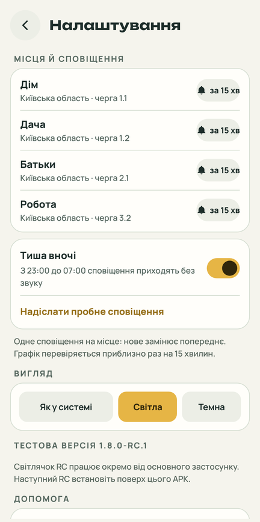
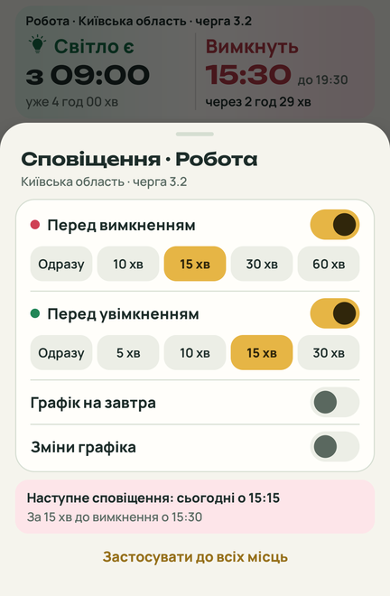
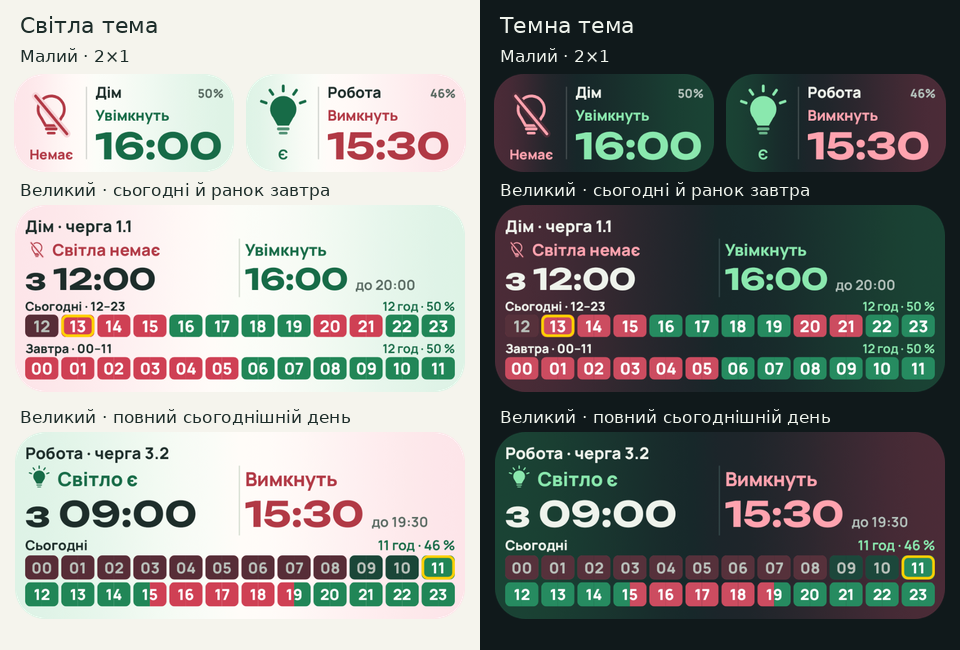
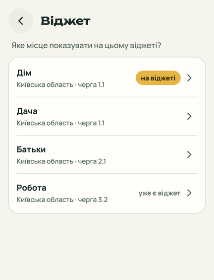
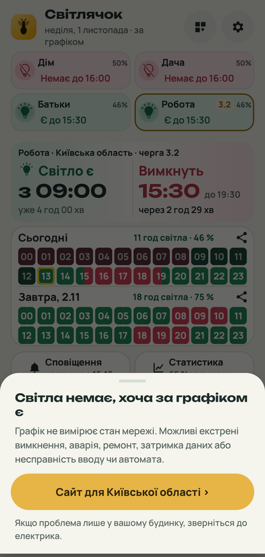

# Світлячок

[](https://github.com/ABovsh/svitlyachok/actions/workflows/ci.yml)
[](https://sonarcloud.io/summary/new_code?id=ABovsh_svitlyachok)
[](https://sonarcloud.io/summary/new_code?id=ABovsh_svitlyachok)
[](https://sonarcloud.io/summary/new_code?id=ABovsh_svitlyachok)
[](https://sonarcloud.io/summary/new_code?id=ABovsh_svitlyachok)
[](https://sonarcloud.io/summary/new_code?id=ABovsh_svitlyachok)
[](https://github.com/ABovsh/svitlyachok/releases/latest)
[](https://github.com/ABovsh/svitlyachok/releases)
[](LICENSE)

Android-застосунок із графіком погодинних відключень світла: чи є світло зараз, до котрої години
і що буде завтра — для одного або кількох місць. Сповіщення приходять перед вимкненням і перед
увімкненням.

Сайт застосунку: **[abovsh.github.io/svitlyachok](https://abovsh.github.io/svitlyachok/)**.

Графіки є для міста Києва і 16 областей (список — у розділі [Області](#області)).

Чергу міста Києва сайт ДТЕК не показує. Знайти її за адресою можна на неофіційному сайті [«Без світла»](https://bezsvitla.com.ua/kyiv#street-search-widget).

Спершу я зробив цей застосунок для тещі, щоб їй було простіше стежити за відключеннями.
Ця версія — для всіх, хто хоче знати графік свого будинку, дачі чи батьків без зайвих кроків.

<p align="center">
  
  
  
  
  
</p>

## 🔒 Приватність

**Застосунок нічого не надсилає з телефона.**

- Застосунок звертається до мережі у двох випадках: завантажує відкритий файл графіка вашої
  області з GitHub (`raw.githubusercontent.com`) і, коли ви його відкриваєте (не частіше двох
  разів на день), питає `github.com`, яка версія остання. У запитах немає ваших місць, черг чи
  налаштувань. Пропущена версія більше не показується — лише наступна. Нова версія
  завантажується лише після натискання «Оновити» і лише з випуску цього репозиторію.
- Місця, черги й налаштування зберігаються тільки на телефоні. Вони не потрапляють у
  резервну копію Google і не переносяться на інший телефон.
- Без облікового запису, реклами, аналітики й сторонніх бібліотек.
- Лише зашифровані з'єднання (HTTPS): незашифровані заборонені в налаштуваннях безпеки
  застосунку.
- Як і будь-який сайт, GitHub бачить IP-адресу телефона й те, файл якої області завантажено.

Навіщо застосунку дозволи:

| Дозвіл | Навіщо |
|---|---|
| Інтернет, стан мережі | завантажити графік і перевіряти його оновлення |
| Встановлення застосунків | встановити нову версію Світлячка, завантажену з цього репозиторію; Android попросить дозволу, коли ви вперше натиснете «Оновити» |
| Сповіщення | попередити перед вимкненням і увімкненням |
| Точні будильники | щоб сповіщення приходило точно у свій час |
| Запуск після ввімкнення телефона | відновити сповіщення й віджети після перезавантаження |
| Виняток з економії батареї | один раз запитати, щоб телефон не відкладав сповіщення |

## Можливості

### 📅 Графік вашої черги

- Що зараз за графіком, відколи й скільки триває: «Світло є з 09:00, уже 4 год».
- Наступна подія, її час і скільки до неї: «Вимкнуть 15:30 до 19:30, через 2 год 29 хв».
- Сьогодні й завтра: 24 годинні клітинки двома рядами й підсумок очікуваного світла. Половина клітинки — 30 хвилин. Минулі години темніші, поточна виділена жовтою рамкою.
- Місто Київ і 16 областей — [список](#області).

### 🔔 Сповіщення

- Одразу після встановлення увімкнено два: за 15 хвилин до вимкнення і за 15 хвилин до
  увімкнення світла.
- Для кожного місця — свої: кнопка «Сповіщення» під графіком відкриває налаштування вибраного місця і показує, коли прийде наступне. Їх можна застосувати до всіх місць.
- Що станеться, а нижче — коли: «🔴 Вимкнуть світло» / «о 18:30». Коли місць
  кілька, другий рядок починається з назви місця: «Дім · о 18:30».

  
- [Докладніше про сповіщення](#сповіщення)

### 📍 Кілька місць

- До 4 місць з різними областями чи чергами: дім, дача, батьки, робота. Одну чергу тієї самої області можна додати лише раз.
- Кожне місце — компактна плитка зі станом і відсотком очікуваного світла сьогодні; натисніть, щоб побачити графік.

### 📤 Поділитися

- Кнопка в рядку «Сьогодні» і в рядку «Завтра». Графік дня надсилається
  картинкою у Viber, Telegram чи куди завгодно, з посиланням, де завантажити застосунок.
- На картинці — черга, область і дата, без назви вашого місця.

### 🧩 Віджети



- Свій віджет для кожного місця: лампочка, стан, назва місця й час наступної зміни в її кольорі.
- Колір показує, що зараз і що далі: зліва поточний стан, справа наступна подія.
- Два розміри: малий 2×1 і великий 4×2 з погодинною сіткою, як у застосунку. Після полудня, коли з’являється графік на завтра, великий показує сьогодні 12–23 і завтра 00–11. Опівночі повертається повний день 00–23; біля повного дня немає зайвого підпису діапазону. Підсумки годин світла й відсотків завжди за повні доби. На дуже низькому віджеті залишається повний сьогоднішній день.
- Перед зміною половина з наступною подією заливається її кольором, як на картці.
- Оновлюється сам у моменти змін, без відкриття застосунку.
- [Як додати віджет](#віджети)

### 📊 Статистика

- Кнопка «Статистика» під графіком: таблиця всіх місць у відсотках за тиждень і 4 тижні, нижче дні останнього тижня або чотири завершені тижні вибраного місця.
- [Докладніше](#статистика)

### 🔄 Графік оновлюється сам

- Приблизно раз на 15 хвилин застосунок перевіряє, чи обленерго змінило графік, — і коли він
  закритий, і щоразу, коли ви його відкриваєте. Новий графік з'являється на екрані й на
  віджетах сам.
- Поки графік не змінився, перевірка зазвичай не завантажує його заново: спершу дивиться,
  чи є зміни.
- Якщо джерело не відповідає понад 3 години, з'являється попередження, а на екрані лишається
  останній збережений графік.

### ⬆️ Оновлення застосунку

- Про нову версію повідомляє картка на головному екрані: «Оновити», «Що нового» і
  «Пропустити цю версію» — тоді картка з'явиться лише для наступної. Окремих сповіщень про
  оновлення немає.
- «Оновити» завантажує нову версію в застосунок і відразу відкриває встановлення Android —
  без браузера й пошуку файлу.

### 🆘 Повідомити про проблему

- У налаштуваннях, у розділі «Допомога»: форма на GitHub, де технічні дані вже заповнені.
  [Докладніше](#повідомити-про-проблему)

Світла й темна тема — як у системі або на вибір.

## Як читати екран

- **Плитки місць** вгорі: лампочка й колір показують стан зараз, нижче — до котрої години він триває, поруч із назвою — частка дня зі світлом.
- **Кольори**: зелений — світло є, червоний — світла немає, бурштиновий — можливе вимкнення,
  сірий — графіка ще немає. Лампочка дублює стан формою: з променями, перекреслена, наполовину
  залита, контур — тож його видно й без розрізнення кольорів.
- **Картка стану** має дві половини, як великий віджет: зліва що зараз, відколи й скільки триває; справа наступна подія, її час, до котрої години вона триває і скільки до неї лишилось. Перед зміною права половина заливається кольором події.
- **Початок стану** шукається в збережених графіках попередніх днів. За відсутності попередньої історії відлік починається від першого відомого часу, наприклад «з 00:00».
- **Вибране місце** позначене контуром і номером черги на плитці. У картці стану вгорі його назва, область і черга: «Дім · Київська область · черга 3.1».
- **Скора зміна** видна на плитці будь-якого місця: час стає на заливку кольору події за стільки хвилин, скільки вибрано у сповіщеннях місця, інакше за 15 хвилин.
- На вузькому екрані час і підписи в картці можуть трохи зменшитися, щоб уміститися в рядок. Зі збільшеним системним шрифтом половини стають одна під одну, а текст не зменшується.
- **Сьогодні й завтра**: дві компактні секції, у кожній скільки годин світла очікується за графіком: «16 год світла · 67 %». Поки графіка на завтра немає, про це написано в одному рядку.
- **Годинні клітинки**: два ряди по 12, від 00 до 23. Ліва половина — перші 30 хвилин години, права — другі; кольори зберігають усі короткі вимкнення. Жовтий контур позначає поточну годину. Можливе вимкнення має штрихування, невідомі години — сірі.
- **Підказка графіка**: дотик до половини клітинки показує початок, кінець і тривалість її відрізка. Той самий відрізок, дотик поруч або кілька секунд прибирають її.
- **Світла немає, хоча за графіком є?** Рядок унизу пояснює можливі причини: екстрене вимкнення, аварію, ремонт, затримку даних або проблему вводу чи автомата. Кнопка веде до джерела для області вибраного місця; для міста Києва — до «Без світла».

## Докладніше

### Сповіщення

- Перед вимкненням можна обрати «Одразу» (у момент зміни) або 10–60 хвилин наперед, перед
  увімкненням — «Одразу» або 5–30 хвилин.
- Заголовок — «🔴 Вимкнуть світло», «🟢 Увімкнуть світло» або «🟠 Можливе вимкнення».
  Нижче — інтервал і тривалість: «18:30–22:30 · 4 год без світла» або
  «22:30–завтра 02:30 · 4 год світла». Якщо кінець інтервалу невідомий, про це написано.
  Коли місць два й більше, другий рядок починається з назви місця. Залишок часу відлічує Android;
  повний текст із довгою назвою доступний після розгортання.
- Усе це налаштовується окремо для кожного місця — кнопкою «Сповіщення» під графіком або дзвіночком
  у рядку місця в налаштуваннях. Там же видно час наступного сповіщення і є «Застосувати до всіх місць».
- Нагадування й повідомлення про графік показуються окремо: оновлення графіка не прибирає активний
  відлік. Повідомлення кількох місць зібрані в групу. Нагадування заздалегідь зникає в момент зміни;
  перенесення або скасування події прибирає старе нагадування, уточнення інтервалу оновлює його без
  повторного звуку. Нагадування у момент зміни лишається до кінця відомого вимкнення або на годину після увімкнення.
- Додатково, якщо потрібно, вмикаються:
  - **Графік на завтра** — щойно обленерго його опублікує, з підсумком годин світла;
  - **Зміни графіка** — якщо обленерго змінило години на сьогодні або завтра;
  - **Тиша вночі** — з 23:00 до 07:00 сповіщення приходять без звуку (одна для всіх місць).
- Кнопка «Надіслати пробне сповіщення» показує, як виглядають обидва сповіщення.

Повідомлення про графік відрізняє новий день від зміни вже відомих годин: «Графік на завтра» або
«Зміни на сьогодні». Якщо змінилися обидва дні — «Графік оновлено» з окремими підсумками сьогодні
й завтра. Дотик відкриває потрібне місце. Неповний графік позначений словами, а за можливих вимкнень
показано мінімальну кількість годин світла.

### Віджети

Додати віджет можна трьома способами:

- щойно ви додали нове місце, з'являється пропозиція поставити його віджет на головний екран;
- кнопка віджета в шапці головного екрана — для обраного місця;
- через список віджетів телефона — окремі варіанти «Малий · 2×1» та «Великий · 4×2», потім вибір місця; без вибору віджет не додається.

Під час додавання із застосунку також можна одразу вибрати малий або великий віджет. Збільшувати малий вручну не обов'язково; вже додані малі й великі віджети продовжують працювати.

  

Коли місць кілька, на віджеті завжди видно назву місця. Віджет оновлюється й після
перезавантаження телефона.

### Статистика

- **Таблиця місць**: відсоток світла за тиждень і за 4 тижні та зміна до попереднього тижня. Дотик до рядка показує графік місця.
- **Тиждень**: сім днів, зелене зі світлом знизу, червоне без світла зверху. Бурштинове зі штрихуванням — можливе вимкнення, порожній контур — немає даних.
- **4 тижні**: чотири завершені періоди по сім днів до вчора. Для кожного — середні години світла на добу та відсоток від 24 годин.
- Кількість днів із повним графіком показана, лише коли їх менше семи. Невідомі й неповні дні виключені із середніх; можливі вимкнення не вважаються світлом.
- Історія накопичується на телефоні — до 31 дня. TalkBack читає точні значення; за великого шрифту графік можна гортати горизонтально, щоб підписи не обрізалися.

### Оновлення

- Нова версія встановлюється поверх попередньої, місця й налаштування зберігаються.
- Першого разу Android попросить дозволити Світлячку встановлювати застосунки: увімкніть
  перемикач і поверніться назад — встановлення продовжиться саме. Якщо завантажити не вдалося,
  файл випуску відкривається в браузері.
- Застосунок завантажує файл лише з випуску цього репозиторію й перевіряє, що це Світлячок саме
  тієї версії. Android встановлює його лише тоді, коли він підписаний тим самим ключем, тож чужа
  збірка поверх не стане.

### Повідомити про проблему



- У браузері відкривається форма на GitHub, де технічні дані вже заповнені; потрібен обліковий
  запис GitHub.
- Технічні дані — версія застосунку й Android, модель телефона, область і черга, стан
  сповіщень. Назв ваших місць там немає. Застосунок нічого не надсилає сам: ви бачите текст
  до надсилання.

## Встановлення

### Завантажити готовий APK

1. На телефоні відкрийте [останній випуск](https://github.com/ABovsh/svitlyachok/releases/latest)
   і завантажте файл `Svitlyachok-<версія>.apk`.
2. Відкрийте завантажений файл. Якщо телефон попросить, дозвольте браузеру встановлювати
   застосунки.
3. Запустіть Світлячок (якщо мова телефона не українська, під значком — «Svitlyachok»):
   оберіть область, чергу й назву місця, дозвольте сповіщення.

Про нову версію з'явиться картка на головному екрані; «Оновити» встановлює її. Біля
кожного APK у випуску вказано його SHA-256 — ним можна перевірити, що файл не змінено.

### Зібрати самостійно

Потрібні JDK 17 і Android SDK (API 35).

```bash
git clone https://github.com/ABovsh/svitlyachok.git
cd svitlyachok
./gradlew testDebugUnitTest assembleRelease
```

Готовий файл — `app/build/outputs/apk/release/app-release.apk`, підписаний вашим локальним
ключем налагодження. Через інший підпис він не встановиться поверх APK зі сторінки випусків:
спершу видаліть попередню версію.

## Області

Місто Київ, Київська, Вінницька, Дніпропетровська, Житомирська, Закарпатська, Запорізька,
Івано-Франківська, Львівська, Одеська, Полтавська, Рівненська, Тернопільська, Хмельницька
Черкаська, Харківська й Чернігівська.

Графіки беруться з відкритих архівів на GitHub, які збирають їх із сайтів обленерго:
[Baskerville42/outage-data-ua](https://github.com/Baskerville42/outage-data-ua),
[yaroslav2901/OE_OUTAGE_DATA](https://github.com/yaroslav2901/OE_OUTAGE_DATA),
[olnet93/gpv-voe-vinnytsia](https://github.com/olnet93/gpv-voe-vinnytsia),
[vn-progr/gpv-voe-vinnytsia](https://github.com/vn-progr/gpv-voe-vinnytsia) і
[milkmann/gpv-zoe-zaporizhzhia](https://github.com/milkmann/gpv-zoe-zaporizhzhia).

## Важливо

Застосунок показує графік, який публікує обленерго, а не фактичну наявність світла у вашому
будинку. Застосунок не пов'язаний з ДТЕК чи іншими обленерго.

Як застосунок влаштований — [ARCHITECTURE.md](ARCHITECTURE.md), що змінилося —
[CHANGELOG.md](CHANGELOG.md). Про вразливість повідомте за [SECURITY.md](SECURITY.md).

## Ліцензія

[MIT](LICENSE). Шрифти Unbounded і Manrope — SIL Open Font License
([`app/src/main/assets/fonts`](app/src/main/assets/fonts)).
